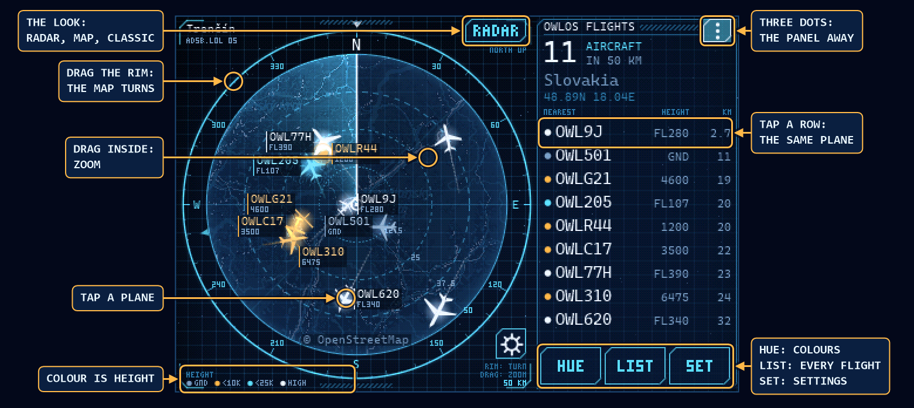
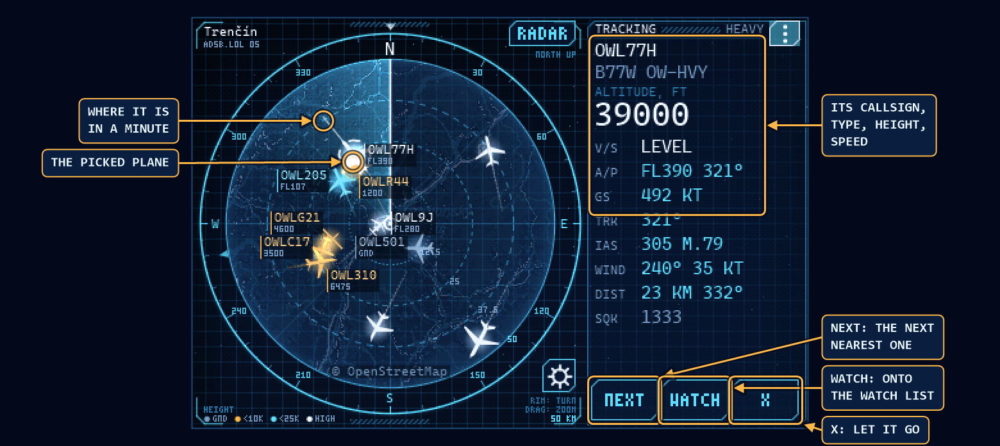
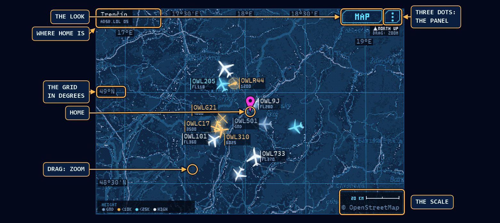
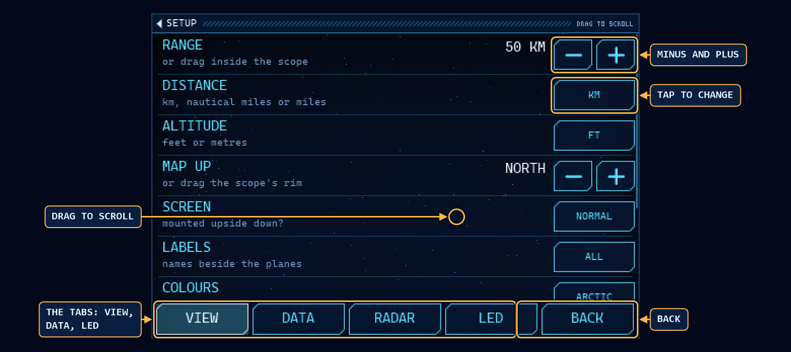
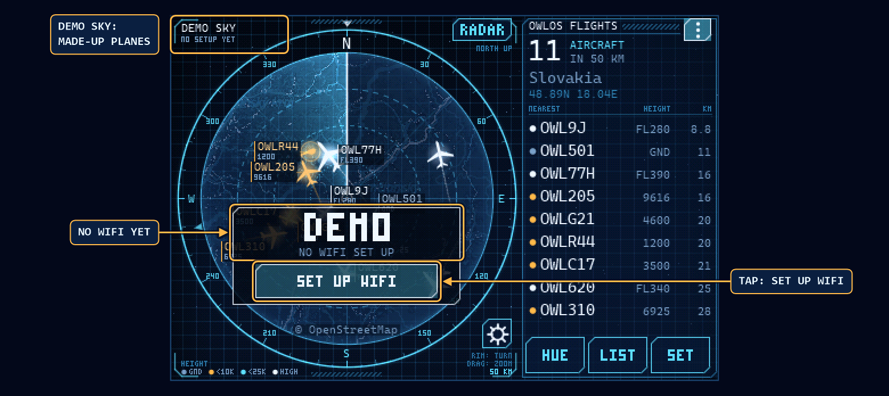
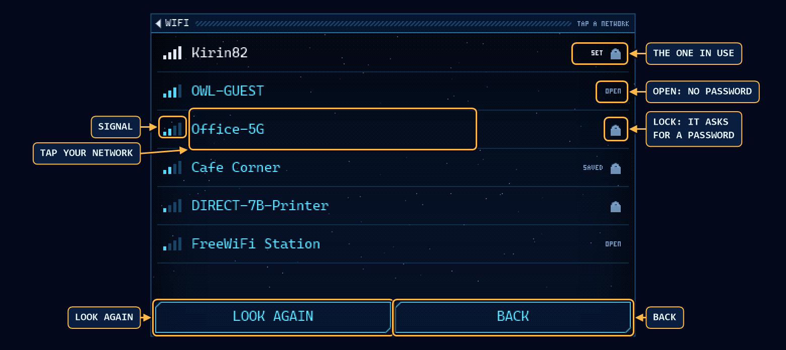
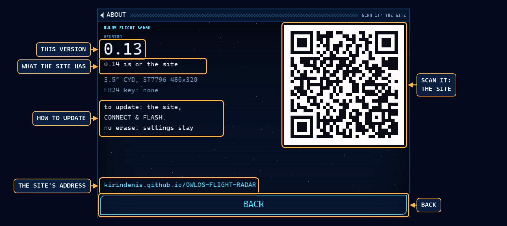
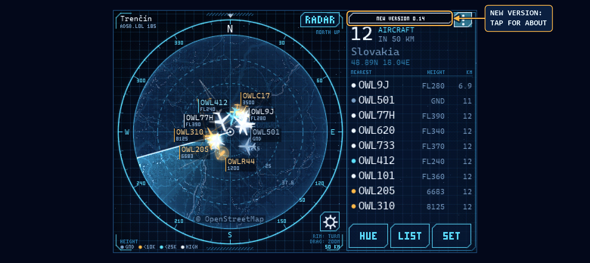
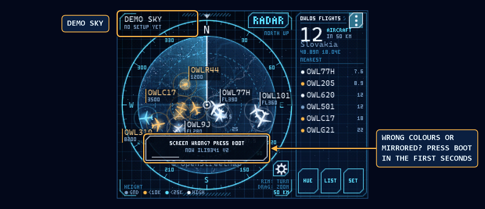
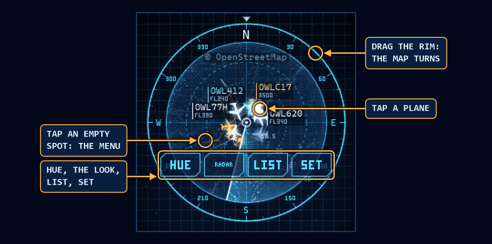

# OWLOS Flight Radar

**Flash it from the browser: [kirindenis.github.io/OWLOS-FLIGHT-RADAR](https://kirindenis.github.io/OWLOS-FLIGHT-RADAR/)**

**Try it in your browser: [the radar in a page](https://kirindenis.github.io/OWLOS-FLIGHT-RADAR/radar/)**, a demo sky, or your own board's planes over the USB cable.

Questions, ideas, a photo of your board: [our group on Facebook](https://www.facebook.com/groups/OWLOS).

The planes around your home on a small ESP32 board with a screen. Each plane is a silhouette turned the
way it flies, coloured by its height, with a trail behind it. Tap one for its callsign, type, height and
speed. The planes come from the free community ADS-B networks, or from Flightradar24 if you have a key.
The map under them comes from OpenStreetMap.

## What it does

- A radar scope with a sweeping beam over the map, or a plain square map, or the same map in
  OpenStreetMap's own colours. One button switches between the three.
- Real distances and bearings round your home. Drag the rim to turn the map the way the screen stands,
  drag inside to zoom from 2 to 250 km (or nautical miles, or miles).
- The nearest planes in a panel, every flight in a list, the picked one with all it is known about it.
- Five colour themes, the colour of a plane always says its height.
- Next to an airport the planes parked and taxiing there can be hidden: SET, ON GROUND.
- A watch list of up to 8 planes: the board picks one when it comes in range, and says when one takes
  off or lands anywhere in the world.
- The RGB LED on the back of the 2.8" and 3.5" CYD lights for what happens: an emergency squawk round
  home, a watched plane coming, taking off or landing, no data. Each one on or off.
- Without WiFi it flies a made-up demo sky and says DEMO in big letters. The WiFi and the home are set
  on the touch screen itself, or from the site over the USB cable.
- It knows its version and finds out by itself when the site has a newer one: a small note on the
  screen opens ABOUT, with a QR code to the site. What changed in each version: [CHANGES.md](CHANGES.md).
- The map pictures are downloaded once and kept in the board's flash: a range it has shown comes back
  at once, even without WiFi.

## The boards

- **2.8" CYD** ("cheap yellow display", ESP32-2432S028R): ESP32, 320x240, resistive touch. Sold with three
  different screens, one build fits them all (see below).
- **3.5" CYD** (ESP32-3248S035, R or C version): ESP32, ST7796 480x320, resistive or capacitive touch. The
  second core draws half the radar.
- LCDWIKI's ESP32-32E boards, also sold by Elegoo: the 2.8" E32R28T takes the 2.8" CYD build and the
  3.5" E32R35T the 3.5" one, the screen and the touch are on the same pins. Only the LED's red is on
  another pin, see The LED.
- **2.8" LCDWIKI ES3C28P**: ESP32-S3, ILI9341V 320x240, capacitive touch (FT6336). Its USB-C is the S3's
  own. New, not run on one here yet: the pins come from LCDWIKI's schematic.
- **2.8" NM-CYD-C5**: the CYD's form on an ESP32-C5, ST7789 320x240, resistive touch, two USB-C ports
  (either works). New, not run on one here yet: the pins come from its maker's schematic.
- **2.8" Elecrow CrowPanel Advance** (the 2.8" HMI ESP32 AI display): ESP32-S3, ST7789 320x240 IPS,
  capacitive touch (FT6336), two USB-C ports (either works). New, not run on one here yet: the pins
  come from Elecrow's examples and schematic.
- **5" Elecrow CrowPanel Advance** (the 5.0" HMI ESP32 AI display, V1.0 to V1.3): ESP32-S3, 800x480 IPS
  on the RGB bus, capacitive touch (GT911). Experimental, never run on a real board here: the pins come
  from Elecrow's examples.
- **5" Guition JC8048W550**: ESP32-S3, 800x480 on the RGB bus, capacitive touch (GT911). Experimental,
  never run on a real board here: the pins come from one board file so far.
- **4.3" ESP32-4827S043C**: ESP32-S3, 480x272 on the RGB bus, capacitive touch (GT911), with a layout of
  its own. Experimental, never run on a real board here: the pins and the panel's timing come from one
  board file. The R version, with resistive touch, is not in this build.
- **7" Elecrow CrowPanel 7.0**, the plain one (DIS08070H), not the Advance: ESP32-S3, 800x480 on the RGB
  bus, capacitive touch (GT911), the 5" boards' layout. Experimental, never run on a real board here: the
  pins come from Elecrow's examples and its V3.0 schematic. Its BOOT button is the screen's clock line, so
  the firmware does not read it.
- **1.28" round** (Elecrow CrowPanel): ESP32-C3, GC9A01 240x240, capacitive touch.
- **3.5" RPi LCD** (Waveshare RPi LCD (A) on the OWLOSAirQuality board): ESP32, ILI9486 480x320, no touch.
- **5" M5Stack Tab5**: ESP32-P4 with an ESP32-C6 for the WiFi, 720x1280 IPS on MIPI-DSI turned to lie
  flat, capacitive touch, through Espressif's board package. Experimental, brought in by Paris Pitts
  (pull request #7), who runs it on one Tab5 (ST7121 panel, board V1.0): the WiFi, planes, the map and
  the touch work. Not run on one here yet, nor on the two other panels the Tab5 is sold with. No BOOT
  the firmware can see; its console is the USB port alone, and the writing is smaller than on the other
  5" boards for now.

## Flash it

1. Open [the site](https://kirindenis.github.io/OWLOS-FLIGHT-RADAR/) in Chrome or Edge on a computer,
   a Chromebook too. Flashing goes over Web Serial: phones and Firefox can't do it.
2. Plug the board in with a USB cable that carries data.
3. Press CONNECT & FLASH under your board, pick its port and say yes to erase.
4. No port in the list? On Windows the CH340 driver may be missing. Won't connect? Hold BOOT while you
   plug it in.
5. Boards with touch ask once for 5 crosses to be pressed, so the touch knows where the screen is.
6. An update is the same button, with no to erase: the board keeps its WiFi, home, watch list and the
   rest.
7. The site keeps every version from 0.2 on. The newest went wrong on your board? Step 1 has a list
   to pick an older one, and the same buttons flash it; `?v=0.3` after the site's address picks one
   from a link. An older version may not read all the settings a newer one saved: the WiFi stays,
   the rest may need sending again.

## WiFi and home

- On the 2.8" and 3.5" CYD: tap **SET UP WIFI** on the demo's card (or SET, the WIFI row), tap your
  network, type its password, JOIN. The home is typed there too: SET, the HOME row.
- From the site, step 2: the WiFi, your home point, where the planes come from and how the screen shows,
  sent over the same USB cable. The round board and the RPi LCD take their WiFi this way.
- The board remembers five networks, the last one set first, and joins whichever it finds: at home, at a
  second home, on a phone's hotspot. A sixth takes the oldest one's place. The site shows them, each with
  **FORGET**.
- Till it gets a home the board sits in Trenčín, Slovakia. The plane network only hears the home rounded
  to about a kilometre: enough to say where to look, not where you live. A town or a postcode typed on
  the board goes to OpenStreetMap's Nominatim to be found, and the board asks Nominatim once for the
  country of each home, with the same rounded point.
- At a home in Rusia the board asks for no planes and no map, and says NOT AVAILABLE IN RUSIA. The
  country is the one OpenStreetMap gives for the home's point: Crimea and the other occupied parts of
  Ukraine are Ukraine there.
- Counting for the site's map of boards, only when you allow it (the page asks once; on the board SET,
  DATA, COUNT ME): every 10 minutes the board tells our server its board type and version, and the page
  tells it a flash it made and how many boards are on its cable. The server turns the address a report
  comes from into a country and keeps no address, no MAC and no home: `server/README.md`. A page shown is
  counted by day and country, without a cookie. Rusia is not counted.
- The password and the Flightradar24 key go into the board and stay there. The board never shows them
  and never sends them back.
- For a local tar1090 feed, send `OWLOS SET {"src":"free","host":"http://10.1.10.43"}` over the
  serial connection. The board appends `/tar1090/data/aircraft.json` and uses only that feed; it
  makes no ADSB.LOL or ADSB.FI requests, including for watched planes. Send `"host":""` to return
  to the built-in free networks.

## Where to tap

The pictures are the 3.5" board, the 2.8" one has the same screens a little smaller.

### The radar

- **Tap a plane** for its details in the panel. A row of the panel's list picks the same plane.
- **Drag the rim** to turn the map: match it to the way the screen stands. Back near north it snaps to
  north up.
- **Drag inside** to zoom: away from home in, toward home out. BOOT steps through 5, 10, 25, 50, 100 and 200.
- **The look**, top right, goes round RADAR, MAP and CLASSIC.
- **HUE** changes the colours, **LIST** shows every flight, **SET** has the settings.
- **Colour is height**: grey on the ground, warm under 10 000 ft, the theme's colour up to 25 000, white
  above. Emergency squawks blink.

### A plane picked

- The panel says its callsign, type and registration, height, speed and track, how far it is and which
  way, its squawk. Flightradar24 adds where it comes from and where it goes.
- The line ahead of it is where it will be in a minute.
- **NEXT** picks the next nearest one, **X** lets it go.
- **WATCH** puts it on the watch list by its registration (lit while it is on it), again takes it off.

### The map

- MAP is a map over the whole screen, north up, home in the middle. CLASSIC is the same map in
  OpenStreetMap's own colours.
- The grid's lines are whole degrees or minutes, named at the edges. The scale is in the corner.
- **The three dots** slide the panel in and out. A picked plane brings it by itself.
- **Drag** anywhere on the map to zoom.

### LIST

- Every flight in range, the nearest first. Drag to scroll.
- **Tap a row** and that plane is picked on the scope. **ZOOM** steps the range, **BACK** goes back.

### SET

- Tabs on the bar: **VIEW** the range, units, map up, the screen upside down, labels, colours, the look,
  the map and the touch alignment; **DATA** planes on the ground shown or hidden, the watch list, where the
  planes come from, home, the WiFi and ABOUT; **RADAR** the radar look's options; **LED** the light on the
  back (2.8" and 3.5" CYD).
- **The gear** under the scope opens the RADAR tab. On the round glass these rows are under VIEW. All of it
  is off until you turn it on, and all of it is for the radar look only:
  - **LOWEST** and **HIGHEST**: only planes between these two heights. The picked plane stays.
  - **DATA BLOCK**: the label says climbing or coming down, and the speed in tens of knots.
  - **AUTOPILOT**: the label says the height set on the autopilot, when the plane sends it: `FL280>350`.
  - **VECTORS**: a line ahead of each plane, its length says how fast.
  - **BEAM STEPS**: a plane moves only when the beam goes over it, as on a real scope.
  - **CLOCK**: the time in UTC, which the board asks from pool.ntp.org only while this is on.
  - **LOST PLANES**: a plane with no position for 12 seconds goes dim and says CST, for coasting.
  - **CONFLICT**: two planes over 5000 ft that will come closer than 3 NM and 1000 ft within two minutes
    blink red with a line between them. This is a toy: it is public data, and nothing to act on.
- A picked plane's panel shows all that is known of it: the height, climb, what is set on the autopilot,
  ground speed, track, airspeed and Mach, the wind where it is, distance, squawk. Not every plane sends all
  of it, and Flightradar24's data has none of what the plane says of itself.
- **Tap a button** to change it, **minus and plus** for numbers. Drag to see the rest.

### No WiFi yet: the demo

- Without WiFi the board flies a made-up sky and says **DEMO** in big letters. Under it why: no WiFi
  set up yet, the one set can't be seen, or its password looks wrong.
- **SET UP WIFI** opens the networks.

### The networks

- The networks the board hears, the strongest first. A lock asks for a password, OPEN does not, SET is
  the one in use, SAVED one it remembers: a tap joins it with no typing.
- **Tap your network**. **LOOK AGAIN** looks round once more. The ESP32 hears 2.4 GHz networks only.

### The password

- Dots for what you typed, the last letter shows for a moment. **SHOW** shows all of it.
- **ABC** gives one capital, **#+=** the signs, **DEL** rubs out, held it goes on.
- **JOIN**: the board joins the network and the real planes come in a few seconds.

### Home

- SET, the HOME row, **CHANGE**: type a town, a postcode, or the point as `48.9 18.1`. **FIND** asks
  OpenStreetMap where it is, a point needs no WiFi. The planes come round the new home at once.
- A postcode is looked for first in the country of the home the board has, then anywhere. One from
  another country goes with its name: `10115, Germany`. OpenStreetMap does not know every full postcode,
  the town's name always works.
- **#+=** has the space. The round board and the RPi LCD take their home from the site.

### Watch

- SET, DATA, the WATCH row (or WATCH on a picked plane's panel): up to 8 planes, by commas. A
  callsign as the plane sends it (EZY12AB, BAW123, not the flight number on a ticket), a registration
  with its dash (G-EUPT), or the hex address (4CA7B4).
  Letters come out as capitals by themselves, **#+=** has the comma and the dash. **SAVE**, empty: nothing
  watched.
- One comes in range: **EZY12AB IN RANGE**, and the board picks it on the scope (unless you picked
  another one). The others it asks the free networks about, one every 15 seconds: **EZY12AB IS FLYING**
  when one takes off anywhere, **LANDED** when it is down. The WATCH row says how many fly and how many
  are in range.
- The round board and the RPi LCD take their list from the site, step 2.

### The LED

- The 2.8" and 3.5" CYD have an RGB LED on the back, the ES3C28P and the NM-CYD-C5 a WS2812. SET's LED
  tab has a row for each thing that lights it, ON or OFF: **SOS** red and blinking fast, an emergency
  squawk (7500, 7600, 7700) round home; **IN RANGE** green, a watched plane comes; **TAKE-OFF** blue;
  **LANDING** cyan; **ANY NEAR** white, any plane in the air within **HOW NEAR** of home (1, 2, 5 or 10 km,
  or nautical miles, or miles); **NO DATA** amber and steady, the WiFi set is not there or no answer. When
  two are lit, the first in that order shows.
- **BRIGHTNESS**: low, mid or high. **HOW LONG**: till the screen is touched (a minute at most),
  10 seconds, or while it lasts. A touch on the screen puts it out. **TEST**: red, green, blue in turn.
- **RED ON**, the CYDs only: GPIO 4 or GPIO 22. The red one is on GPIO 4 on the CYD and on GPIO 22 on
  LCDWIKI's (and Elegoo's) ESP32-32E boards, and nothing on the board tells which. No red in the test: tap
  it, the test runs again on the other pin.
- The site's step 2 has a few ready sets of them, the brightness, how long and the red one's pin.

### ABOUT and a new version

- SET, DATA, **ABOUT**: the version the board runs, the one the site has, the board, whether an FR24
  key is stored, and a QR code to the site with its address under it.
- A board on WiFi asks the site which version it has once it is up, then twice a day (`version.json`
  next to the page). When the site's is newer, a small **NEW VERSION** note shows: in the panel's title
  over the radar, under the town's card over the map, under home on the round glass. A tap on it opens
  ABOUT. Nothing else changes.
- To update: the site on a computer, CONNECT & FLASH, no to erase.

### The 2.8" CYD: which screen

- It is sold with three different screens. It starts as the USB-C one (v2), the one most boards have.
  Wrong colours or a mirrored picture: press **BOOT** in the first seconds after power on. It goes v2,
  v1 (micro USB), v3 (ST7789) and keeps the one you stop at.
- The ES3C28P has the same three and starts as v2 too. The NM-CYD-C5 has two: RGB first, then BGR, for
  red and blue swapped. The CrowPanel Advance has the same two, BGR first. The 5" boards have them too,
  RGB first.

### The round glass

- The whole glass is the scope. **Tap an empty spot** for HUE, the look, LIST and SET.
- **Tap a plane** for its card under home, tap the card for the next one.
- The rim turns the map and inside zooms, like on the square boards.

### And

- **Hold BOOT** to go back to the scope from any page.
- **Hold a finger 4 s** on an empty spot to align the touch again.
- **The RPi LCD** has no touch: BOOT steps through the planes, held it changes the range.

## If it ever stands still

Plug it into a computer and press READ WHAT IT HAS on the site, step 2. The board says how long it has
been running, what it started after (power on, the reset pin, a watchdog, a crash) and, to a minute, how
long the run before lasted. It keeps that through a reset and a power cut. If opening the port restarted
it, the run before is the one that stood still.

## Build it yourself

The firmware is ESP-IDF 5.5. The screen code in `core/` is plain C, the same files build the firmware
and a PC preview.

- `firmware/BUILD.BAT <screen> [COMx]` builds one screen's firmware (and flashes it to COMx). Screens:
  `ili9341` (2.8" CYD, the default), `st7796` (3.5" CYD), `gc9a01` (round), `ili9486` (RPi LCD),
  `es3c28p`, `nmcydc5`, `crowadv28`, `crowadv50`, `jc8048w550`, `tab5`, `esp4827s043`, `crow70`. Each
  screen has its own build folder and sdkconfig.
- `.github/workflows/pages.yml` builds them all in Espressif's ESP-IDF image and publishes the site
  with them on GitHub Pages, on every push to main.
- The version is the first `## ` line of `CHANGES.md`: the firmware is built with it, and the site
  publishes it in `version.json` for the boards and shows the file as its history. A new version is a new
  section at the top of that file.
- The site keeps each version's firmware (`.github/archive.sh`): the newest in `fw/<board>/`, the older
  ones in `fw/<version>/<board>/`, all of them listed in `fw/versions.json`. Each run takes the older
  ones from the site as it is and puts its own build next to them, nothing is built again. Every
  build of a version replaces that version, the older ones are never touched: to keep a build, give
  the next one a new number. A lower number than one the site has, or a file of an older version the
  run can't fetch, stops the workflow and the site stays as it was. Each run also keeps all of them
  as its `site-fw` artifact for 90 days. 0.2 and 0.3 came before the site kept versions: they come
  once from the runs that built them, `.github/archive-seed.txt`.
- `tools/QrBake` (.NET 8) writes the site's address and its QR code into `core/qr_site.h` and `.c`.
- `web/BUILD.BAT` (Emscripten in `C:\emsdk`) builds `core/` for WebAssembly: `web/index.html` is the radar
  in a web page, the 5" layout. A demo sky till a board is connected over Web Serial, then the board's
  planes, and what a finger does on either side goes to the other. Serve that folder with any web server.
- `tools/preview/BUILD.BAT <screen>` (Visual Studio 2022) draws every page on the PC into `shots/`.
  `TOUR.BAT` films the how-to tour, `GIF.BAT` makes the GIF above from it (both with ffmpeg).
- `tools/Guide/GUIDE.BAT` (.NET 8) puts the arrows on the shots: `shots/guide/`, from `notes.txt`.
- `tools/FontBake` bakes the fonts in `core/font_*.c`.
- `tools/WorldBake` (.NET 8) bakes `site/world.js`, the countries of the map of boards, from Natural Earth's
  1:110m countries (public domain): `dotnet run -- ne_110m_admin_0_countries.geojson site`. Natural Earth's
  default file draws Crimea as Russia's: the tool gives it back to Ukraine and stops if a test point of
  Ukraine lands in another country. `site/stats.js` draws the map and the counts from our server's API,
  nothing when it does not answer; `tools/stats-sample.json` is made-up counts for a local look only
  (`bash tools/assemble.sh`, then `index.html?stats=sample`).
- `server/` (.NET 8) is that server, RadarStats, on `radar.owlos.sk`: `server/README.md` says what it keeps,
  `server/deploy/README.md` how it goes on the machine. `server/public-url.txt` is the switch: the site's
  workflow writes it into `version.json`, the page and the boards report only where it says, and empty
  it says nowhere.

What is where:

- `core/`: the sky (the networks' answers read piece by piece), the demo sky, the map from
  OpenStreetMap's tiles, the drawing, the fonts, the pages and the touch.
- `firmware/`: the boards, the screens and the touch chips, WiFi and HTTPS, the tiles in the flash,
  the settings in NVS, the USB console.
- `site/`: the page that flashes the boards and sends them their settings.

## The USB console

The site talks to the board over the USB cable at 115200 baud, a line each way. Scripts can do the same.

- `OWLOS HELLO` is answered with `OWLOS READY flight-radar <version>`.
- `OWLOS GET` is answered with `OWLOS CFG {...}`: the network's name, `nets` (all it remembers, names
  only; `OWLOS SET {"forget":"name"}` takes one out), home (`lat`, `lon`, `place`,
  `country`), `src`, whether a `key` is stored, `up`, `flip`, `theme`, `look`, `map`, `ground`, `watch`,
  `vectors`, `beam_step`, `clock`, `block`, `autopilot`, `lost`, `conflict`, `fl_lo`, `fl_hi`, `utc` (seconds
  since 1970, 0 not known), `led`, `led_level`, `led_hold`, `led_near`, `led_red`, `version`, `newest` (the site's, `""` not heard
  yet), `uptime` and `ran` in seconds, `reset`, and `screen` on the
  2.8" boards. Never the password, never the key.
- `OWLOS SET {...}` with any of `ssid`, `pass`, `key`, `lat`, `lon`, `place`, `country`, `src` (`free` or
  `fr24`), `up` (degrees), `flip`, `theme` (0 to 4), `look` (0 radar, 1 map, 2 classic), `map`, `ground`
  (1 planes on the ground shown, 0 hidden), `vectors`, `beam_step`, `clock`, `block`, `autopilot`, `lost`,
  `conflict` (each 1 on, 0 off), `fl_lo`, `fl_hi` (flight levels, 0 no limit), `watch`
  (`"EZY12AB, G-EUPT"`, `""` empties it), `led` (what
  lights it, added up: 1 SOS, 2 in range, 4 take-off, 8 landing, 16 any near, 32 no data), `led_near`
  (1, 2, 5 or 10 of the distance unit), `led_level` (0 low, 1 mid,
  2 high), `led_hold` (0 till touched, 1 10 s, 2 while it lasts), `led_red` (4 or 22, the red one's GPIO),
  `led_test` (1: red, green, blue once),
  `screen` (0 v1, 1 v2, 2 v3; on the NM-CYD-C5, the CrowPanel Advance and the 5" boards 0 RGB, 1 BGR).
  What is left out stays as it is. Answered with `OWLOS OK` or `OWLOS ERR <why>`.

## Data and licences

- The code is MIT licensed, see `LICENSE`.
- Planes: [adsb.lol](https://adsb.lol/) (ODbL) and [adsb.fi](https://adsb.fi/), or
  [Flightradar24](https://fr24api.flightradar24.com/) with your own key.
- The map and the town names: © [OpenStreetMap](https://www.openstreetmap.org/copyright) contributors (ODbL).
- Flashing from the browser: [ESP Web Tools](https://esphome.github.io/esp-web-tools/).
